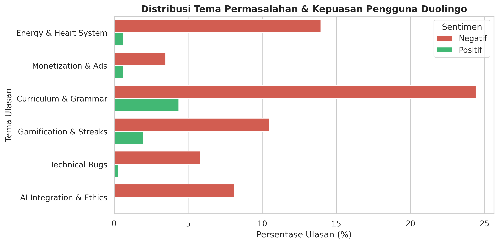

# Analisis Sentimen Ulasan Duolingo: Pendekatan Komparatif Machine Learning & Deep Learning

Repositori resmi untuk naskah **International Conference (INACELT 2026)** (*manuscript submitted / presented; awaiting proceedings publication*) yang mengevaluasi performa klasifikasi sentimen pada ulasan pengguna **Duolingo** dari Google Play Store dengan menerapkan protokol pencegahan kebocoran data (*no-leakage protocol*).

## Ringkasan Metodologi

1. **Pencegahan Data Leakage:** Pelatihan model menggunakan *Early Stopping* yang memantau *Validation Set* independen, menjaga data uji tetap murni (*out-of-domain holdout*).
2. **Sanitasi Data Uji:** Melakukan deduplikasi teks untuk menjamin independensi sampel (*i.i.d.*) pada 750 ulasan unik yang dikumpulkan pada November 2026.
3. **Model yang Diuji:**
   * **Majority Baseline** (*Dummy Classifier* — selalu memprediksi kelas mayoritas positif)
   * **Multinomial Naive Bayes** (TF-IDF unigram & bigram)
   * **Logistic Regression** (TF-IDF unigram & bigram dengan regularisasi L2)
   * **Bidirectional LSTM (BiLSTM)** dengan *SpatialDropout1D* dan *Embedding* 64-dimensi

## Hasil Evaluasi Metrik Komparatif

Berikut adalah hasil pengujian performa model pada dataset eksternal Google Play Store ($n = 750$):

| Model | Accuracy | Balanced Acc | Macro Precision | Macro Recall | Macro F1 | F1 Negatif | F1 Positif |
| :--- | :---: | :---: | :---: | :---: | :---: | :---: | :---: |
| **Majority Baseline** | 0.885 | 0.500 | 0.443 | 0.500 | 0.470 | 0.000 | 0.939 |
| **Multinomial NB** | 0.887 | 0.845 | 0.737 | 0.845 | 0.774 | 0.615 | 0.934 |
| **Logistic Regression** | **0.928** | **0.888** | **0.810** | **0.888** | **0.843** | **0.727** | **0.959** |
| **BiLSTM** | 0.919 | 0.883 | 0.791 | 0.883 | 0.828 | 0.702 | 0.953 |

> Uji statistik **McNemar** menunjukkan tidak ada perbedaan signifikan antara Logistic Regression dan BiLSTM ($p = 0.189$). Oleh karena itu, model linier yang lebih ringan dan mudah diinterpretasikan (**Logistic Regression**) sangat memadai untuk tugas ini.

## Visualisasi Hasil & Analisis Tematik

### Perbandingan Confusion Matrix


### Distribusi Tematik Ulasan Duolingo


### Tren Diskusi AI Bulanan


## Struktur Repositori

| File | Deskripsi |
| :--- | :--- |
| [`duolingo_sentiment_bilstm_ml.ipynb`](https://github.com/nasy-sr/analisis-sentimen-duolingo/blob/main/duolingo_sentiment_bilstm_ml.ipynb) | Notebook eksperimen utama (preprocessing, protokol *no-leakage*, pelatihan & evaluasi 4 model, uji McNemar, dan analisis tematik). |
| [`tabel_hasil_model_final.csv`](https://github.com/nasy-sr/analisis-sentimen-duolingo/blob/main/tabel_hasil_model_final.csv) | Ringkasan metrik evaluasi komparatif seluruh model pada data uji. |
| [`tabel_lr_tanpa_kata_ai.csv`](https://github.com/nasy-sr/analisis-sentimen-duolingo/blob/main/tabel_lr_tanpa_kata_ai.csv) | Hasil evaluasi ablasi fitur Logistic Regression tanpa kata kunci terkait AI. |
| [`coding_B2_final.csv`](https://github.com/nasy-sr/analisis-sentimen-duolingo/blob/main/coding_B2_final.csv) | Data hasil pengodean tematik ulasan pengguna. |
| [`tabel_coding_B2_per_periode.csv`](https://github.com/nasy-sr/analisis-sentimen-duolingo/blob/main/tabel_coding_B2_per_periode.csv) | Rekapitulasi distribusi tema ulasan per periode waktu. |
| [`validasi_C_isi_label_terisi.csv`](https://github.com/nasy-sr/analisis-sentimen-duolingo/blob/main/validasi_C_isi_label_terisi.csv) | Dataset hasil validasi pelabelan sentimen manual. |

## Prasyarat & Instalasi

Pastikan pustaka berikut terinstal di lingkungan Python atau Google Colab Anda:

```bash
pip install numpy pandas scikit-learn tensorflow matplotlib seaborn
