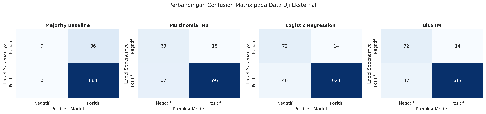
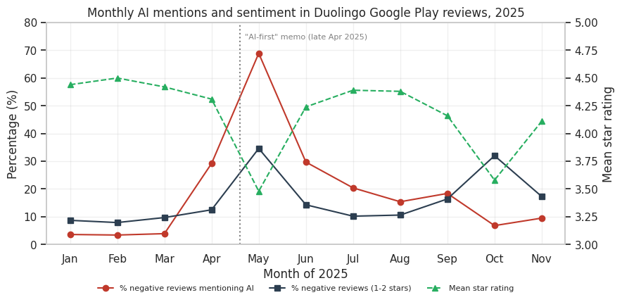

# User Perceptions of AI Integration in Mobile-Assisted Language Learning: Sentiment Classification and User Backlash Against AI Adoption in Duolingo Reviews

Repositori resmi untuk naskah **[International Conference on English Language Teaching, Linguistics, and Literature (INACELT 2026)](https://www.inacelt2026.my.id/)** (*manuscript submitted / presented; awaiting proceedings publication*) yang ditulis oleh **Nasywa Salsabiila Romadhona** *(First Author)*, **Abdul Aziz**, dan **Dwi Wahyu Prabowo** (Universitas Darwan Ali).

Penelitian ini menggunakan pendekatan *convergent mixed-methods* untuk mengevaluasi klasifikasi sentimen ulasan **Duolingo** dari Google Play Store dengan protokol pencegahan kebocoran data (*no-leakage protocol*), menganalisis aspek keluhan pengguna, serta memetakan respons terhadap kebijakan *"AI-first"* Duolingo (akhir April 2025).

## Ringkasan Metodologi & Dataset

* **Data Latih & Uji (*No-Leakage*):** Dilatih pada **38.278 ulasan seimbang** (19.139 positif, 19.139 negatif; 90% train / 10% validation) dari korpus publik Kaggle 2025, dan diuji pada **750 ulasan unik terdeduplikasi** (664 positif, 86 negatif) dari Google Play Store yang dikumpulkan pada 8–9 November 2026. Vectorizer dan tokenizer di-*fit* hanya pada data latih.
* **Model yang Dibandingkan:**
  * **Majority Baseline** (*Dummy Classifier* — selalu memprediksi kelas mayoritas positif)
  * **Multinomial Naive Bayes** (TF-IDF unigram & bigram, 5.000 fitur)
  * **Logistic Regression** (TF-IDF unigram & bigram dengan regularisasi L2)
  * **Bidirectional LSTM (BiLSTM)** (*Embedding* 64-dimensi, *SpatialDropout1D* 0.3, lapisan BiLSTM 64 & 32 unit, *early stopping* pada *validation loss*)

## Hasil Evaluasi Metrik Komparatif ($n = 750$)

| Model | Accuracy | Balanced Acc | Macro Precision | Cohen's κ | Macro F1 [95% CI] | F1 Negatif |
| :--- | :---: | :---: | :---: | :---: | :---: | :---: |
| **Majority Baseline** | 0.885 | 0.500 | 0.443 | 0.000 | 0.470 [0.464, 0.476] | 0.000 |
| **Multinomial NB** | 0.887 | 0.845 | 0.737 | 0.553 | 0.774 [0.730, 0.815] | 0.615 |
| **Logistic Regression** | **0.928** | **0.888** | **0.810** | **0.687** | **0.843 [0.803, 0.881]** | **0.727** |
| **BiLSTM (seed 42)** | 0.919 | 0.883 | 0.791 | 0.657 | 0.828 [0.785, 0.867] | 0.702 |
| **BiLSTM (5 seeds, M ± SD)** | 0.922 ± 0.009 | 0.876 ± 0.010 | — | — | 0.831 ± 0.013 | 0.708 ± 0.022 |

> Uji **McNemar** eksak menunjukkan tidak ada perbedaan signifikan antara Logistic Regression dan BiLSTM ($p = 0.189$), sedangkan keduanya mengungguli Naive Bayes ($p \le 0.001$). Model linier **Logistic Regression** lebih ringan dan mudah diinterpretasikan untuk kebutuhan ini.

## Temuan Utama: Aspek Negatif, Tren Bulanan & Qualitative Coding

* **Aspek Dominan Sentimen Negatif:** Pada data uji ($n = 750$), ulasan negatif paling banyak menyangkut **kurikulum & tata bahasa** (24,4%), **sistem energi/nyawa** (14,0%), dan **gamifikasi/streak** (10,5%), sementara isu **AI** muncul pada 8,1% ulasan negatif.
* **Uji Ablasi Kata Kunci AI:** Koefisien negatif terbesar pada Logistic Regression adalah `"ai"` (-11,18). Saat kata terkait AI di-*masking*, Macro F1 hanya bergeser tipis dari 0,843 menjadi 0,830 (F1 negatif dari 0,727 menjadi 0,706), menandakan performa pada data uji 2026 tidak bergantung pada satu token saja.
* **Lonjakan Mei 2025 & Kode Kualitatif:** Dari 19.254 ulasan negatif menyebut AI pada korpus 2025 (Jan–Nov), puncaknya terjadi pada **Mei 2025** (68,9% ulasan negatif menyebut AI; 61,9% dari total ulasan negatif ber-AI berada di bulan Mei). Hasil *coding* 100 ulasan negatif ber-AI (intra-rater $\kappa = 0{,}770$) dengan pembobotan populasi menunjukkan:
  * **REJECT** (penolakan tanpa alasan spesifik): **47,4%**
  * **LABOUR** (kekhawatiran penggantian staf/penerjemah manusia): **27,0%**
  * **QUALITY** (penurunan kualitas materi, terjemahan, atau pelafalan suara): **19,3%**
  * **FEATURE / INCIDENTAL / OTHER**: **6,3%**

## Visualisasi Hasil & Analisis Tematik

### Perbandingan Confusion Matrix


### Distribusi Tematik Ulasan Duolingo


### Tren Diskusi AI Bulanan


## Struktur Repositori

| File | Deskripsi |
| :--- | :--- |
| [`duolingo_sentiment_bilstm_ml.ipynb`](https://github.com/nasy-sr/analisis-sentimen-duolingo/blob/main/duolingo_sentiment_bilstm_ml.ipynb) | Notebook eksperimen utama (*preprocessing*, protokol *no-leakage*, pelatihan & evaluasi model, uji McNemar, ablasi AI, dan analisis tematik). |
| [`tabel_hasil_model_final.csv`](https://github.com/nasy-sr/analisis-sentimen-duolingo/blob/main/tabel_hasil_model_final.csv) | Ringkasan metrik evaluasi komparatif seluruh model pada data uji. |
| [`tabel_lr_tanpa_kata_ai.csv`](https://github.com/nasy-sr/analisis-sentimen-duolingo/blob/main/tabel_lr_tanpa_kata_ai.csv) | Hasil evaluasi ablasi fitur Logistic Regression tanpa kata kunci terkait AI. |
| [`coding_B2_final.csv`](https://github.com/nasy-sr/analisis-sentimen-duolingo/blob/main/coding_B2_final.csv) | Data hasil pengodean tematik ulasan pengguna. |
| [`tabel_coding_B2_per_periode.csv`](https://github.com/nasy-sr/analisis-sentimen-duolingo/blob/main/tabel_coding_B2_per_periode.csv) | Rekapitulasi distribusi tema ulasan per periode waktu. |
| [`validasi_C_isi_label_terisi.csv`](https://github.com/nasy-sr/analisis-sentimen-duolingo/blob/main/validasi_C_isi_label_terisi.csv) | Dataset hasil validasi pelabelan sentimen manual. |

## Prasyarat & Instalasi

```bash
pip install numpy pandas scikit-learn tensorflow matplotlib seaborn
